  

  
  
  

## About me

I'm a full-stack developer based in Warsaw. I build complete web applications, from backend architecture and the database to a polished interface. I feel most at home in **NestJS** on the backend and use **Next.js / React** on the frontend.

- 💼 Previously worked as a **Frontend Developer**.
- 🤖 I add AI to products in a way that stays **predictable and safe**: function calling with permission checks, human-in-the-loop approvals, structured JSON output validated against a schema, and RAG with sources.
- ✅ Every project ships with unit tests, GitHub Actions CI, Swagger docs and a live demo.

## Featured projects

**[AI Agent Platform](https://github.com/MaksZiem/ai-agents-platform)**: configure AI agents, run multi-step tasks with real tools, and approve sensitive actions in real time. It includes a BullMQ execution engine with retries and cancellation, live timelines over Socket.IO, an SSRF guard, and AES-256-GCM encrypted API connections. 
`NestJS` `Next.js 16` `BullMQ` `Socket.IO` `PostgreSQL` `Redis` `Gemini` 
[Live demo](https://ai-agents-platform.zmax-dev.pl) · [API docs](https://api.ai-agents-platform.zmax-dev.pl/api/docs)

**[AI Observability](https://github.com/MaksZiem/ai-observability)**: ingests logs, traces, errors and deployments, correlates them into incidents, and lets AI analyze them from structured evidence. It covers error fingerprinting, anomaly detection, trace waterfalls, alerting, and a dead-letter ingest queue. 
`NestJS` `Next.js 16` `BullMQ` `SSE` `PostgreSQL` `Redis` `Gemini` 
[Live demo](https://ai-observability.zmax-dev.pl) · [API docs](https://api.ai-observability.zmax-dev.pl/api/docs)

**[Workout Tracker](https://github.com/MaksZiem/workout-tracker)**: a strength training app with plans, a planner and progress stats (e1RM, records, stagnation). Gemini turns plain text into logged sets and goals into training plans, limited to the exercise catalog. 
`NestJS` `Next.js 16` `OpenAPI` `next-intl` `PostgreSQL` `Gemini` 
[Live demo](https://workout-tracker.zmax-dev.pl) · [API docs](https://api.workout-tracker.zmax-dev.pl/api/docs)

**[AI Notes](https://github.com/MaksZiem/ai-notes)**: Notion-style notes with real-time co-editing (Yjs CRDT), granular sharing, semantic search, RAG chat over your notes, and a tool-using AI agent. 
`NestJS` `React 19` `Tiptap` `Yjs` `Hocuspocus` `PostgreSQL` `Gemini` 
[Live demo](https://ai-notes.zmax-dev.pl) · [API docs](https://api.ai-notes.zmax-dev.pl/api/docs)

## Tech stack

**Languages**&nbsp;

**Backend**&nbsp;

**Frontend**&nbsp;

**Data & real-time**&nbsp;

**AI**&nbsp;

**Testing & tooling**&nbsp;

## Contact

Have a project, a product idea or a job offer? I'd be glad to talk about what I can build.

📫 [mtziembicki@gmail.com](mailto:mtziembicki@gmail.com) · 💼 [LinkedIn](https://www.linkedin.com/in/maksymilian-ziembicki-b81864351/) · 🌐 [zmax-dev.pl](https://www.zmax-dev.pl)

Off the keyboard: Chelsea FC since I was a kid, Formula 1 (Mercedes-AMG Petronas), Great Britain, and lately 3D graphics.
